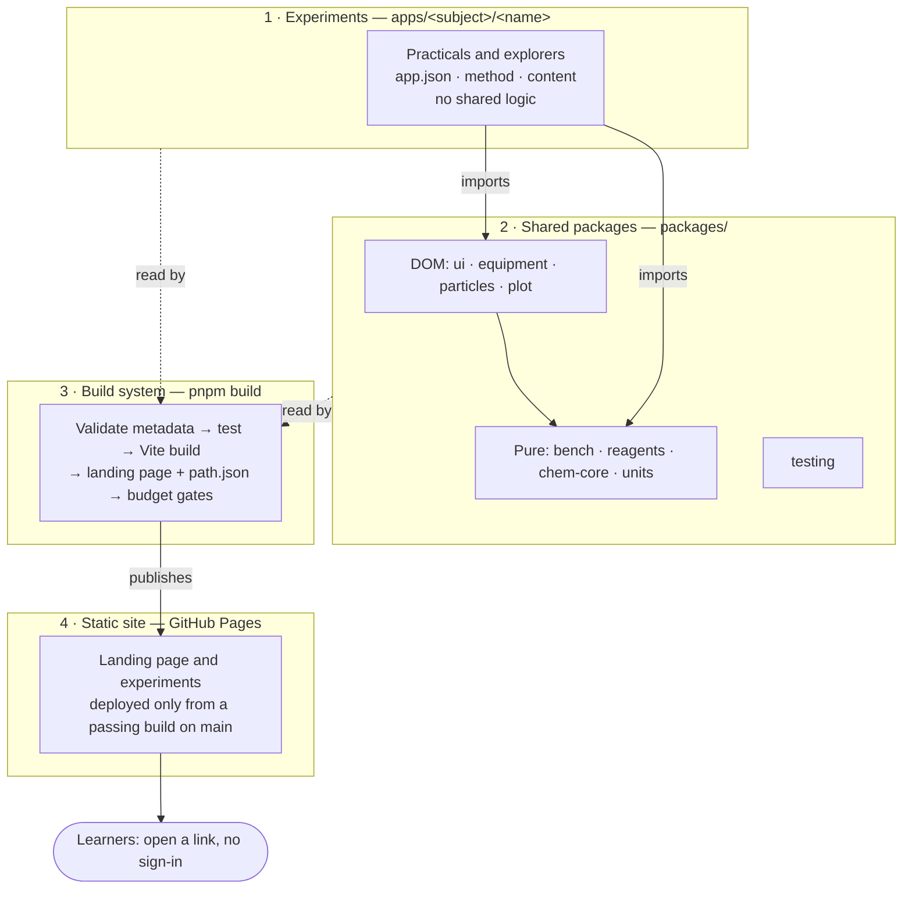

# Chenji Labs: Product System and Roadmap

Nov 20, 2026 · @Mas'ud Ndatsu

## Summary

Chenji Labs is built in four layers. Three live in one repository: experiments, which hold no shared logic; shared packages, which hold no interface for any single experiment; and a build system that turns experiment metadata into the fourth layer, the static site on GitHub Pages. Each layer can depend only on the layers below it. Inside, the packages are organised like a school lab: a chemical store, an equipment cupboard and a bench. This doc sets out that system and a revised roadmap that fixes the gaps found in PRD v0.1.

The key decisions:

- **Science lives in packages, never in pages.** Every equation sits in a pure, tested function. Pages only connect controls to those functions.
- **Metadata is the source of truth.** `app.json` drives the landing page, the learning-path graph and CI validation. Prerequisites that point nowhere fail the build.
- **Budgets are enforced, not hoped for.** CI fails a pull request that goes over 150 KB, makes a remote request, or is missing a required section.
- **Review works with one maintainer from day one.** Admin bypass and an interim chemistry reviewer stay in place until a second maintainer joins.
- **Every phase has exit criteria.** A phase ends when its gate is met, not when its weeks run out.

## Learner journey

A learner never signs in. They open a link, change a variable, and get pointed to the next experiment.

1. Open a link: a teacher's link to one experiment, or the landing page.
2. On the landing page, see the subject's path, each experiment's step and what to do first.
3. Read the aim, change the controls and watch the result.
4. Work through the What to try prompts and reveal the answers.
5. Answer Check your understanding to test the concept.
6. Follow the link to the next experiment on the path.

Every part of the system below exists to keep this journey under 3 seconds to start, and correct.

## The lab model

Chenji Labs is organised like a school chemistry lab. Each part of a real lab maps to one part of the code. Building a new experiment then mostly means picking tools and reagents and writing the method.

| In a real lab | In Chenji Labs | Lives in |
| --- | --- | --- |
| Chemical store: labelled bottles with formula, concentration and hazard symbols | Reagent catalogue: data for each substance, and the solutions made from it | `reagents` |
| Equipment cupboard: glassware and instruments | Equipment library: each tool is a small SVG component with its own behaviour | `equipment` |
| The bench, where tools are set up and used | Bench runtime: tracks what is in each vessel and runs actions such as pour, add dropwise, heat and stir | `bench` |
| The laws of chemistry | Science models: pure functions that work out pH, temperature, colour, rate and voltage | `chem-core`, `units` |
| Practical sheet: aim, apparatus, method, safety | Experiment definition: apparatus list, reagents, method steps and safety notes | `apps/<subject>/<name>` |
| Lab notebook: results table and graph | Notebook: records each reading, plots it and exports CSV, kept only in the learner's browser | `bench`, `plot` |
| Teacher or lab demonstrator | What to try, Check your understanding and hints | `ui` |

Tools never contain chemistry, and the chemistry never knows which tool is involved. A vessel holds contents: substances, amounts and temperature. When an action changes the contents, the bench asks `chem-core` for the new state, and every instrument reads from that state. So a pH meter works in any beaker, in any experiment.

There are two kinds of experiment:

- **Practicals** follow a method at the bench, take readings and fill in the notebook. Example: acid–base titration.
- **Explorers** let the learner change a variable directly and watch a model, with no glassware. Example: the particle model. A practical can link to an explorer that shows what is happening at the particle level.

A virtual lab lets learners make mistakes safely. They can overshoot an end point, forget to rinse the burette or misread the meniscus, then see how it changes their results. That builds the technique that school practical exams test.

## Equipment and reagents

The starting cupboard holds 16 tools. Together they cover the volumetric, rates, gas, energy and electrochemistry practicals on a senior secondary syllabus. Each tool is an SVG drawing under about 5 KB. A tool joins `equipment` once a second experiment needs it, the same rule as for packages.

| Tool | What it does at the bench | Reads or sets | First needed by |
| --- | --- | --- | --- |
| Beaker | Holds and mixes a solution | Contents, volume | pH of everyday solutions |
| Conical flask | Holds the analyte; swirl to mix | Contents | Acid–base titration |
| Measuring cylinder | Measures approximate volumes | Volume to 0.5 cm³ | Thiosulfate rates |
| Pipette and filler | Delivers one exact volume | 25.00 cm³ | Acid–base titration |
| Burette | Adds titrant, down to one drop; read at the meniscus | Volume to 0.05 cm³ | Acid–base titration |
| Volumetric flask | Makes a solution up to an exact volume | 100 or 250 cm³ | Standard solution |
| Balance | Weighs solids | Mass to 0.01 g | Standard solution |
| pH meter | Reads the pH of the vessel it is dipped in | pH to 0.01 | pH of everyday solutions |
| Indicators | Change colour across their pH range | Colour | Acid–base titration |
| Thermometer | Reads temperature | Temperature to 0.5 °C | Gas laws |
| Water bath or hot plate | Holds the contents at a set temperature | Temperature | Gas laws |
| Stopwatch | Times a reaction | Seconds | Thiosulfate rates |
| Gas syringe | Collects gas and shows its volume and pressure | Volume, pressure | Gas laws |
| Colorimeter | Measures how much light a solution absorbs | Absorbance | Dilution series |
| Calorimeter (polystyrene cup) | Holds a reaction with little heat loss | Temperature change | Enthalpy of neutralisation |
| Voltmeter, electrodes and salt bridge | Measures the voltage of a cell | Volts | Daniell cell |

The chemical store starts with the reagents those practicals need: HCl, H₂SO₄, CH₃COOH, NaOH, NH₃(aq), Na₂CO₃, Na₂S₂O₃, magnesium ribbon, CuSO₄, ZnSO₄, copper, zinc, distilled water, phenolphthalein, methyl orange and universal indicator. Each entry holds a formula, its acid or base constants where they apply, colour, GHS hazard pictograms and a cited source. Molar mass is computed by `chem-core` rather than stored.

### Qualitative analysis kit

Qualitative analysis adds eight tools, bringing the cupboard to 24. These are the test-tube tools for identifying ions and gases.

| Tool | What it does at the bench | Reads or sets | First needed by |
| --- | --- | --- | --- |
| Test tubes and rack | Hold small samples for each test | Contents | Every QA test |
| Dropping pipette | Adds reagent a few drops at a time, then in excess | Drops, excess | Cation tests |
| Test-tube holder and Bunsen burner | Warms or heats a sample | Temperature | Cation tests (ammonium) |
| Flame-test wire | Holds a sample in the flame | Flame colour | Flame tests |
| Litmus paper, red and blue | Tests a gas or solution | Colour change | Gas tests |
| Limewater and delivery tube | Tests a gas for CO₂ | Milky or clear | Gas tests |
| Wooden splint | Glowing or lit, to test for O₂ and H₂ | Relights or pops | Gas tests |
| Filter funnel and paper | Separates a precipitate from the solution | Residue, filtrate | Identify salt X |

New reagents: dilute HNO₃, AgNO₃(aq), BaCl₂(aq), limewater, FeSO₄(aq), concentrated H₂SO₄, H₂O₂ and MnO₂. Unknown salts are built from 10 cations (NH₄⁺, Na⁺, K⁺, Ca²⁺, Al³⁺, Zn²⁺, Pb²⁺, Fe²⁺, Fe³⁺, Cu²⁺) and 4 anions (Cl⁻, SO₄²⁻, CO₃²⁻, NO₃⁻).

Qualitative analysis is modelled as data, not equations:

- **Observation table.** `chem-core` gains a table where each row maps an ion, a reagent and an amount (a few drops or excess) to an observation, such as "white precipitate, soluble in excess". Every row cites a source and is approved by a chemistry reviewer.
- **Words, not just colours.** Every observation is written out as well as drawn, so no result depends on colour alone (FR-E3).
- **Seeded unknowns.** Salt X is picked from a seed, so each attempt is different. A teacher can share a link with a fixed seed so the whole class tests the same salt, with no accounts.
- **Exam-format notebook.** QA experiments use the Test, Observation, Inference table that school practical exams use.
- **Safer than the real thing.** Tests with lead salts and concentrated acid can be practised with no risk, while the safety notes still teach how they are handled in a real lab.

## Example experiments

Ten experiments show the kit at work. After titration, most new practicals need only one or two new tools, so the cupboard stops growing well before the experiment list does.

| Experiment | Kind | Equipment | Reagents | Model | Step |
| --- | --- | --- | --- | --- | --- |
| Particle model | Explorer | None (particle box) | — | Kinetic theory | 2 |
| Boyle's and Charles's laws | Practical + explorer | Gas syringe, thermometer, water bath | Air | pV = nRT | 2 |
| Standard solution | Practical | Balance, beaker, volumetric flask | Na₂CO₃, water | c = n / V | 2 |
| Dilution series | Practical | Pipette, volumetric flask, colorimeter | CuSO₄, water | Beer–Lambert law | 2 |
| pH of everyday solutions | Practical | Beaker, pH meter, universal indicator | HCl, CH₃COOH, NH₃(aq), NaOH | Acid and base equilibria | 3 |
| Acid–base titration | Practical | Burette, pipette, conical flask, indicator, pH meter | HCl, NaOH, phenolphthalein | Acid–base equilibrium | 4 |
| Magnesium and acid | Practical | Gas syringe, balance, stopwatch | Mg, HCl | Rate from gas volume | 4 |
| Thiosulfate "disappearing cross" | Practical | Conical flask, measuring cylinder, stopwatch, thermometer, water bath | Na₂S₂O₃, HCl | Rate law, Arrhenius | 4 and 5 |
| Enthalpy of neutralisation | Practical | Calorimeter, thermometer, measuring cylinder | HCl, NaOH | q = mcΔT | 5 |
| Daniell cell | Practical | Beakers, electrodes, salt bridge, voltmeter | CuSO₄, ZnSO₄, Cu, Zn | Nernst equation | 5 |

Acid–base titration is the flagship practical. It uses the most tools, it is the practical exams test most, and it teaches technique: rinsing, reading the meniscus, finding concordant titres. It replaces "titration curves" in the learning path, and the pH meter view shows the curve as the learner titrates.

### Qualitative analysis experiments

Five QA practicals build up to the classic exam task: identify both ions in an unknown salt. All five sit at Step 3, Reactions.

| Experiment | Equipment | Reagents | What the learner works out | Prerequisites |
| --- | --- | --- | --- | --- |
| Flame tests | Flame-test wire, Bunsen burner | Salts of Na, K, Ca and Cu | The metal ion, from the flame colour | Atomic structure |
| Gas tests | Test tubes, splint, litmus, limewater and delivery tube | Mg and HCl; a carbonate and acid; H₂O₂ and MnO₂; an ammonium salt and NaOH | Which gas is given off: H₂, CO₂, O₂ or NH₃ | None |
| Cation tests | Test tubes, dropping pipette, holder and burner, litmus | NaOH(aq), NH₃(aq) | The cation, from the precipitate and how it behaves in excess | Gas tests |
| Anion tests | Test tubes, dropping pipette, limewater and delivery tube | HNO₃, AgNO₃, BaCl₂, HCl, FeSO₄, concentrated H₂SO₄ | The anion, from a precipitate or a gas | Gas tests |
| Identify salt X | Full QA kit, filter funnel and paper | A seeded unknown salt and all QA reagents | Both ions, recorded in exam format | Cation tests, anion tests |

Identify salt X is the capstone. It gives no hints until the learner submits an inference. Then it shows which observation pointed to the right ion, or which one they misread.

## System overview



Dependencies run in one direction only, downward: experiments use packages, the build reads both, and only a passing build on `main` reaches learners.

## Packages and dependency rules

There are nine packages, each with a role in the lab. Phase 1 builds the core of the kit, because the pH simulator and gas laws are both bench experiments. `plot` waits until Phase 2, when titration and rates need graphs.

| Package | Lab role | Owns | May depend on | Phase |
| --- | --- | --- | --- | --- |
| `units` | Measurement standards | Constants (CODATA), unit conversion, significant figures, instrument precision | nothing | 1 |
| `chem-core` | The laws of chemistry | Acid–base, gas, rate, energy and cell models; formula parser; molar mass | `units` | 1, growing each phase |
| `reagents` | Chemical store | Substance data, solutions, hazard pictograms, sources | `units`, `chem-core` | 1 |
| `bench` | Bench and notebook | Vessel contents, actions (pour, add, heat, stir), event log, notebook, CSV export | `chem-core`, `reagents` | 1 |
| `equipment` | Equipment cupboard | SVG tools that act on the bench or read from it | `bench`, `ui` | 1 with 5 tools, 16 by Phase 3 |
| `ui` | Page and demonstrator | Page shell, controls, What to try, Check your understanding, theme | `units` | 1 |
| `particles` | Particle-level view | Particle box for explorers, with a text summary for screen readers | `units`, `ui` | 1 |
| `plot` | Notebook graphs | SVG line and scatter graphs with a data-table fallback | `units` | 2 |
| `testing` | Quality control | Worked-example harness: inputs, the textbook answer and a tolerance | nothing | 1 |

The rules CI enforces:

1. Experiments may import packages. Packages never import experiments.
2. `units`, `chem-core`, `reagents` and `bench` are pure: no DOM access, no browser APIs. They run in Node tests unchanged.
3. Only `ui`, `equipment`, `particles` and `plot` touch the DOM.
4. Equipment acts on the bench and reads its state. It never calls `chem-core` directly, so changing a model never touches a drawing.
5. No runtime dependency from npm without a written reason in the pull request. Dev dependencies are free.
6. Every exported science function has at least one worked-example test and one limiting-case test, such as V → ∞ or \[H⁺\] → 0.

`bench` is pure, so a whole practical can be tested without a browser. For example: fill the burette with 0.100 mol/dm³ NaOH, run in 25.00 cm³, and check that phenolphthalein has turned pink. Reviewers can then check the method, not just the equation. `testing` turns those worked examples into one shared table format.

## Experiment contract

Every experiment has the same files and the same page sections, so the template, CI and reviewers can all check it in the same way.

```
apps/chemistry/acid-base-titration/
  app.json          metadata, apparatus and reagents, validated at build
  index.html        page shell from ui
  main.js           sets up the bench and places equipment; no equations here
  method.js         practical sheet: steps, safety notes, notebook columns
  science.js        experiment-specific model code not yet in chem-core
  science.test.js   worked examples and a full method run on the bench
  content.js        all learner-facing text (ready for translation)
```

The page sections, in order: Aim, Apparatus and reagents, Safety, Bench (controls and live result), Notebook, Conditions, What to try, Check your understanding, Science behind this, Next steps. Explorers leave out Apparatus and reagents, Safety and Notebook. `ui` provides a component for each. The build checks that each one is present in the output HTML.

The `app.json` schema for v0.2, with the fields marked planned in the PRD made required:

| Field | Required | Rule |
| --- | --- | --- |
| `title` | yes | 60 characters or fewer |
| `summary` | yes | One sentence, 140 characters or fewer |
| `kind` | yes | `practical` or `explorer` |
| `level` | yes | One of: `junior-secondary`, `senior-secondary`, `first-year-university` |
| `step` | yes | Integer from 1 to 6 within the subject |
| `prerequisites` | yes, may be empty | List of `subject/name`; each must exist and must sit at the same step or an earlier one |
| `apparatus` | practicals only | List of tool ids; each must exist in `equipment` |
| `reagents` | practicals only | List of reagent ids; each must exist in `reagents` |
| `sources` | yes, at least one | Objects with `title` and either `url` or `isbn` |
| `tags` | no | Lowercase strings |
| `status` | no | `draft` or `published`; drafts build but stay off the landing page |

The build also rejects prerequisite cycles. `status: draft` lets a contributor merge work in progress without publishing a half-finished experiment.

## Build, CI and deploy

One command, `pnpm build`, runs the whole pipeline. CI runs the same command, so a pull request that builds on a laptop builds in CI.

1. **Validate metadata.** Check every `app.json` against the schema. Resolve prerequisites, and reject missing targets, cycles and backward steps.
2. **Test.** Run all package and experiment tests with the Node test runner.
3. **Build experiments.** Vite builds each app into `dist/<subject>/<name>/` with the base path from the repository name.
4. **Generate the site.** `landing.mjs` writes the landing page and a `path.json` learning-path graph from the metadata.
5. **Check budgets.** Run the gates below on the built output.
6. **Deploy.** Only on `main`: GitHub Actions publishes `dist/` to Pages.

| Gate | Fails the PR when | Phase added |
| --- | --- | --- |
| Schema | A required field is missing or invalid, a prerequisite is broken, or an apparatus or reagent id is unknown | 1 |
| Tests | Any test fails | 0 (exists) |
| Size | An experiment's first load is over 150 KB, uncompressed HTML + JS + CSS | 1 |
| No remote requests | Built HTML, JS or CSS references any origin other than its own | 1 |
| Sections | A page section required for the experiment's kind is missing | 1 |
| No-JS fallback | The page has no `<noscript>` message | 1 |
| Accessibility | axe-core finds a serious or critical issue at 360 px | 2 |
| Load time | Lighthouse with Slow 4G throttling and a mid-range phone CPU takes over 3 s to interactive | 3 |

The size and remote-request gates are a short script over `dist/`. They need no new runtime dependency. Lighthouse waits until Phase 3, because it is slow and flaky in CI until there are enough pages to justify it.

## Contribution and review

Review runs in two modes. The project starts in solo mode and moves to team mode once a second maintainer joins. Which mode is active is written in `GOVERNANCE.md`, so contributors know what to expect.

|  | Solo mode (now) | Team mode (target: end of Phase 2) |
| --- | --- | --- |
| Maintainers | Project lead only | Two or more |
| Required approvals | One, from a maintainer who isn't the author | One, from a maintainer who isn't the author |
| Lead's own PRs | Admin bypass after CI passes and a 48-hour public review window | Normal review |
| Chemistry check | Project lead as interim subject reviewer | One named chemistry reviewer per step |
| CODEOWNERS | `*` → lead | `packages/` → maintainers; `apps/chemistry/` → chemistry reviewers |

Review happens in a fixed order: chemistry, then learner experience, then code. Each stage has its own checklist in the pull request template. A PR that fails the chemistry check gets no code review, which saves reviewer time.

The contributor path:

1. Pick an issue labelled `good first experiment` or `good first fix`, or open an experiment idea using the issue form.
2. Run `pnpm new-app chemistry <name>`. This copies the template with every section stubbed and `status: draft`.
3. Write `science.js` and its worked-example table first. Open a draft PR so the chemistry review can start early.
4. Build the page. Run `pnpm build` locally, which runs every CI gate.
5. Mark the PR ready, get reviews, squash-merge, and then set `status: published` in a follow-up PR.

Recruiting a second maintainer and chemistry reviewers is roadmap work with its own exit criterion, not a hope. Good places to look: university chemistry departments and teachers from the pilot.

## Chemistry learning path

The path has 18 experiments across six steps. Each one's prerequisites are proposed below so `app.json` can be filled in from day one. Prerequisites are in brackets; experiments already built are in bold.

| Step | Experiments (prerequisites) | Phase |
| --- | --- | --- |
| 1 Foundations | Periodic table explorer; atomic structure (periodic table); unit conversion; molar mass (periodic table, unit conversion) | 2 |
| 2 Matter | Particle model (atomic structure); gas laws (particle model, unit conversion); concentration and dilution (molar mass) | 1 for particle model and gas laws, 2 for concentration |
| 3 Reactions | Equation balancer (molar mass); stoichiometry and limiting reagent (equation balancer); **pH simulator** (concentration) | 2; pH is built |
| 4 Change | Acid–base titration (pH, stoichiometry); rates of reaction (particle model); equilibrium (rates) | 3 |
| 5 Energy | Thermodynamics (equilibrium); electrochemistry (thermodynamics); Arrhenius kinetics (rates, thermodynamics) | 3 |
| 6 Quantum and spectroscopy | Particle in a box (atomic structure); spectroscopy (particle in a box) | 4 |

The other practicals in Example experiments join this path at the steps shown there, as they are built. Two things are out of order on purpose. Particle model and gas laws come before Step 1, because gas laws is the second experiment needed to justify `particles`. The pH simulator's prerequisite list stays empty until concentration is built. A prerequisite can't point to an experiment that doesn't exist, even one in `draft` status.

## Roadmap and phase gates

There are six phases, and each one ends only when its gate is met. That way the project grows on proof, not on dates. The week ranges are targets. Phase 1 is now four weeks instead of two, because it carries the CI gates and the pilot.

| Phase | Target | Delivers | Gate to leave it |
| --- | --- | --- | --- |
| 0 Foundation | Done | Repository scaffold, pH simulator, tests, CI, deploy workflow, contribution templates | **Gate 1:** repo pushed under its final name, Pages live, CI passing, branch protection in solo mode and code owners set |
| 1 Lab core | Weeks 1 to 4 | `units`, `ui`, `testing`, `chem-core`, `reagents`, `bench`, `particles`; first 5 tools (beaker, pH meter, gas syringe, thermometer, water bath); pH simulator moved onto the bench; particle model and gas laws; `app.json` v0.2 and the Phase 1 CI gates; learning path on the landing page; pilot | **Gate 2:** pH simulator and gas laws both run on the bench and share `units` and `ui`; a full method passes a Node test; the landing page shows the path; a teacher or small group has tried them and given written feedback |
| 2 Volumetric kit | Weeks 5 to 12 | Pipette, burette, conical flask, volumetric flask, balance, indicators; standard solution, dilution series, pH of everyday solutions, acid–base titration; the rest of Steps 1 to 3; `plot` and the notebook graph; accessibility gate; contributor guide with "add a tool" and "add a reagent" recipes; second maintainer recruited | **Gate 3:** Steps 1 to 3 and titration published; every tool in the equipment package is used by two experiments, and a tool used only once stays in its experiment; one external PR merged; second chemistry reviewer in place; team mode on |
| 3 Qualitative analysis | Weeks 13 to 18 | The 8 QA tools; QA reagents and the observation table for 14 ions in `chem-core`; flame tests, gas tests, cation tests, anion tests, identify salt X; seeded unknowns with shareable class links; Test, Observation, Inference notebook | **Gate 4:** all five QA practicals published; every row of the observation table sourced and approved by a chemistry reviewer; a teacher has run identify salt X with a class from one shared link |
| 4 Rates and energy | Months 5 to 7 | Stopwatch, measuring cylinder, calorimeter, colorimeter, cell kit; magnesium and acid, thiosulfate, enthalpy of neutralisation, Daniell cell; the rest of Steps 4 and 5; offline caching for visited experiments; teacher notes; Lighthouse gate | **Gate 5:** Steps 4 and 5 published, all 24 tools in the cupboard, offline use works, every experiment has teacher notes, and no accuracy bug open for more than two weeks |
| 5 Reach | Month 8 onward | Step 6; physics subject on the same bench (circuits, optics); first translation; external accessibility audit | Reviewed every quarter against the PRD's success metrics |

If a gate slips, the next phase doesn't start. Instead, the gap becomes the top issue on the board.

## Decisions needed now

Eight decisions are open, and the first five block Phase 1. Each one has a recommendation, so it can be made in one sitting.

| Decision | Recommendation | Needed by |
| --- | --- | --- |
| GitHub organisation and repo | A new org kept apart from the business product, such as `chenjilabs`, with the repo `chenjilabs.github.io` so the site serves at the root and links stay short | Phase 1, day 1 |
| Syllabus to follow first | WAEC/NECO senior secondary chemistry, mapped topic by topic in `docs/syllabus.md`; first-year university second | Phase 1, week 1 |
| `level` values | The three in the schema above | Phase 1, week 1 |
| Interim chemistry reviewer | Project lead, written into `GOVERNANCE.md` | Phase 1, week 1 |
| Pilot teacher or class | One named teacher with a class that has phones, agreed before gas laws is built | Phase 1, week 2 |
| Second chemistry reviewer | Recruit from university chemistry departments or pilot teachers | Gate 3 |
| Remember finished experiments | Yes, in the learner's own browser only (localStorage), with no account and nothing sent off the device | Phase 4 |
| JavaScript to TypeScript | Move the shared packages first, using JSDoc types now so the switch is mechanical; experiments stay JavaScript unless a contributor asks | Gate 3 |

The PRD's other open questions can wait. Languages belong to Phase 5 and teacher guides to Phase 4. How to measure reach and how to sustain the project get decided at Gate 3.
